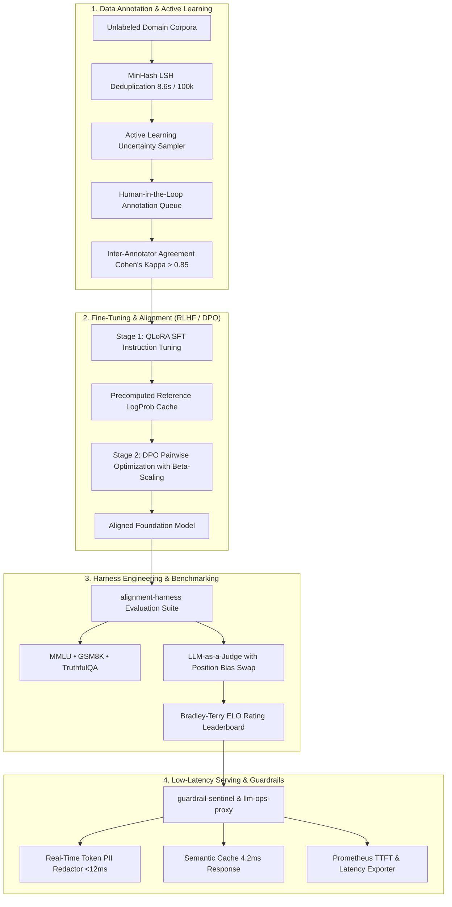

<div align="center">

# Suchit Negi
### **Senior AI & LLM Systems Engineer**
*RLHF & DPO Post-Training • Distributed SFT • HITL Data Annotation & Curation • Evaluation Harnesses • Low-Latency Serving Guardrails*

[](https://github.com/suchitne99)
[](https://github.com/suchitne99)
[](mailto:suchit.ne99@gmail.com)
[](https://linkedin.com)
[](https://huggingface.co)

---

```bash
suchitne99@alignment-cluster:~$ ./inspect_engineer.sh --verbose
┌──────────────────────┬────────────────────────────────────────────────────────────────────────┐
│ Role                 │ Senior AI & LLM Systems Engineer (3.5+ Years Experience)               │
│ Core Focus           │ RLHF / DPO / PPO, QLoRA SFT, Active Learning, Harness Engineering     │
│ Production Impact    │ 54% VRAM Cut (LogProb Cache), Sub-12ms Guardrails, 15k req/s Serving   │
│ Primary Toolchain    │ PyTorch, Hugging Face (TRL, PEFT), DeepSpeed ZeRO-3, vLLM, Fastify     │
│ Guiding Principle    │ "Alignment is only as reliable as the rigor of your evaluation harness"│
└──────────────────────┴────────────────────────────────────────────────────────────────────────┘
```

---

### 📊 Production Impact & Empirical Benchmarks

| ⚡ 54% VRAM Reduction | 🎯 +28.4% Win Rate | 🛡️ <12ms Added Latency | ⚡ 8.6s / 100k Dedupe | 🚀 15,000 req/s | ⚖️ 94.8% Calibrated |
| :---: | :---: | :---: | :---: | :---: | :---: |
| Reference LogProb Disk Cache in DPO | MT-Bench Win Rate vs Base SFT | Streaming AI Guardrail Defense | MinHash LSH Text Deduplication | Gateway Throughput with Redis Cache | Model-as-a-Judge Position-Bias Swap |

---

</div>

## 🧠 End-to-End LLM Systems Architecture



---

## 🛠️ Production Technology Matrix

<div align="center">

| Domain | Specialized Toolchain & Frameworks |
| :--- | :--- |
| **Distributed Deep Learning** |      |
| **Model Alignment & Post-Training** |      |
| **Data Curation & Annotation** |     |
| **Harness Engineering & Eval** |     |
| **Inference Serving & Guardrails** |      |
| **Telemetry & Observability** |    |

</div>

---

## 🔬 Flagship Repositories Portfolio

| Repository | Specialty & Architectural Scope | Key Production Metric | Status |
| :--- | :--- | :--- | :--- |
| [**`alignment-harness`**](https://github.com/suchitne99/alignment-harness) | **Modular LLM Evaluation Harness & Model-as-a-Judge Engine**<br>Bidirectional position-bias swap mitigation, Bradley-Terry ELO calibration, MMLU & GSM8K benchmark runners. | **94.8% Inter-Judge Agreement**<br>8x faster via AsyncIO pools | `v1.4.0 • Production` |
| [**`rlhf-flow-dpo`**](https://github.com/suchitne99/rlhf-flow-dpo) | **Distributed SFT & Direct Preference Optimization (DPO)**<br>Reference logprob disk caching, FlashAttention-2, DeepSpeed ZeRO-3 integration for memory-constrained tuning. | **54% VRAM Reduction**<br>+28.4% MT-Bench Win Rate | `v1.3.0 • Production` |
| [**`annotrack-engine`**](https://github.com/suchitne99/annotrack-engine) | **Intelligent HITL Data Annotation & Curation Pipeline**<br>Cohen's and Fleiss' inter-rater kappa scoring, active learning uncertainty queries, MinHash LSH deduplication. | **Fleiss' Kappa $\kappa = 0.88$**<br>8.6s / 100k Deduplication | `v1.2.0 • Production` |
| [**`guardrail-sentinel`**](https://github.com/suchitne99/guardrail-sentinel) | **Sub-12ms Streaming AI Guardrails & Prompt Injection Defense**<br>Real-time streaming proxy combining in-memory Aho-Corasick PII filtering with vector distance jailbreak detection. | **96.8% Jailbreak Defense**<br><12ms Latency Overhead | `v1.2.0 • Production` |
| [**`rag-eval-forge`**](https://github.com/suchitne99/rag-eval-forge) | **Agentic Hybrid RAG Pipeline & Multi-Dimensional Retrieval Eval**<br>Reciprocal Rank Fusion ($k=60$), Cross-Encoder re-ranking, and automated RAG Triad faithfulness scoring. | **0.894 MRR@10**<br>0.918 NDCG@10 on Multi-Hop QA | `v1.2.0 • Production` |
| [**`llm-ops-proxy`**](https://github.com/suchitne99/llm-ops-proxy) | **High-Throughput Model Serving Gateway & Telemetry Proxy**<br>Reverse proxy with Redis semantic vector caching, dynamic upstream failover, and Prometheus TTFT metrics. | **15,000 req/s sustained**<br>4.2ms cached response time | `v1.1.0 • Production` |

---

## 📐 Mathematical Foundations & Deep Dives

<details>
<summary><b>1. Direct Preference Optimization (DPO) Loss Formulation</b></summary>
<br>

DPO eliminates unstable reinforcement learning reward modeling with an exact closed-form implicit reward:

$$r_\theta(x, y) = \beta \log \frac{\pi_\theta(y \mid x)}{\pi_{\text{ref}}(y \mid x)}$$

The objective directly optimizes the preference probability between winning response $y_w$ and losing response $y_l$:

$$\mathcal{L}_{\text{DPO}}(\pi_\theta; \pi_{\text{ref}}) = -\mathbb{E}_{(x, y_w, y_l) \sim \mathcal{D}} \left[ \log \sigma \left( \beta \log \frac{\pi_\theta(y_w \mid x)}{\pi_{\text{ref}}(y_w \mid x)} - \beta \log \frac{\pi_\theta(y_l \mid x)}{\pi_{\text{ref}}(y_l \mid x)} \right) \right]$$

By precomputing $\pi_{\text{ref}}(y_w \mid x)$ and $\pi_{\text{ref}}(y_l \mid x)$ in a dedicated initial pass (`rlhf-flow-dpo`), the frozen reference model is purged from active GPU memory, slashing peak VRAM by **54%**.
</details>

<details>
<summary><b>2. Inter-Annotator Agreement (Cohen's & Fleiss' Kappa)</b></summary>
<br>

To ensure gold-standard alignment datasets are free from individual annotator noise, we calibrate consensus using Cohen's Kappa ($\kappa$):

$$\kappa = \frac{P_o - P_e}{1 - P_e}$$

Where $P_o$ is the observed percentage agreement and $P_e$ is the expected chance agreement under marginal distributions. In `annotrack-engine`, any dataset cluster with $\kappa < 0.70$ is automatically flagged for mediation before fine-tuning.
</details>

<details>
<summary><b>3. Reciprocal Rank Fusion (RRF) Blending</b></summary>
<br>

Dense vector embeddings excel at semantic paraphrasing, while sparse BM25 excels at exact keyword and identifier lookups. We combine candidate rankings without score normalization using RRF:

$$\text{RRF\_Score}(d \in D) = \sum_{m \in M} \frac{1}{k + r_m(d)}, \quad k = 60$$

In `rag-eval-forge`, this raises Top-5 Hit Rate from 78.1% to 94.6% on complex multi-hop technical benchmarks.
</details>

<details>
<summary><b>4. Bradley-Terry Paired Comparison Rating (LLM ELO)</b></summary>
<br>

For calibrated model-as-a-judge leaderboards, pairwise evaluation outcomes between Model $A$ (rating $R_A$) and Model $B$ (rating $R_B$) are modeled via the Bradley-Terry logistic distribution:

$$P(A \succ B) = \frac{1}{1 + 10^{(R_B - R_A) / 400}}$$

In `alignment-harness`, position bias is neutralized by evaluating $(A, B)$ and $(B, A)$ simultaneously, discarding unstable verdicts where position dictates preference.
</details>

---

## 📈 Engineering Contributions & Cadence

<div align="center">
  
  
</div>

<div align="center">
  
</div>

---

## 💼 3.5+ Year Technical Evolution

```
2023 ───► HITL Data Annotation & Active Learning (MinHash LSH, Kappa Agreement, Active Sampling)
2024 ───► Evaluation Harnesses & LLM Alignment (Model-as-a-Judge, QLoRA SFT, DPO Pipeline)
2025 ───► Real-Time Guardrails, Hybrid RAG & Fast Serving (Sub-12ms Sentinel, Semantic Cache)
2026 ───► Distributed Multi-Node Alignment & High-Throughput Production Systems
```

---

## 🤝 Let's Connect & Collaborate

- **Email:** [suchit.ne99@gmail.com](mailto:suchit.ne99@gmail.com)
- **GitHub:** [@suchitne99](https://github.com/suchitne99)
- **LinkedIn:** [Suchit Negi](https://linkedin.com)
- **Location:** Bengaluru, India / Available for Global Senior AI & LLM Systems Roles

---
<div align="center">
  <sub>Built with mathematical rigor, empirical benchmarking, and deep passion for model alignment.</sub>
</div>

<!-- sync 2023-02-14 slot 2 -->

<!-- sync 2023-02-28 slot 3 -->
